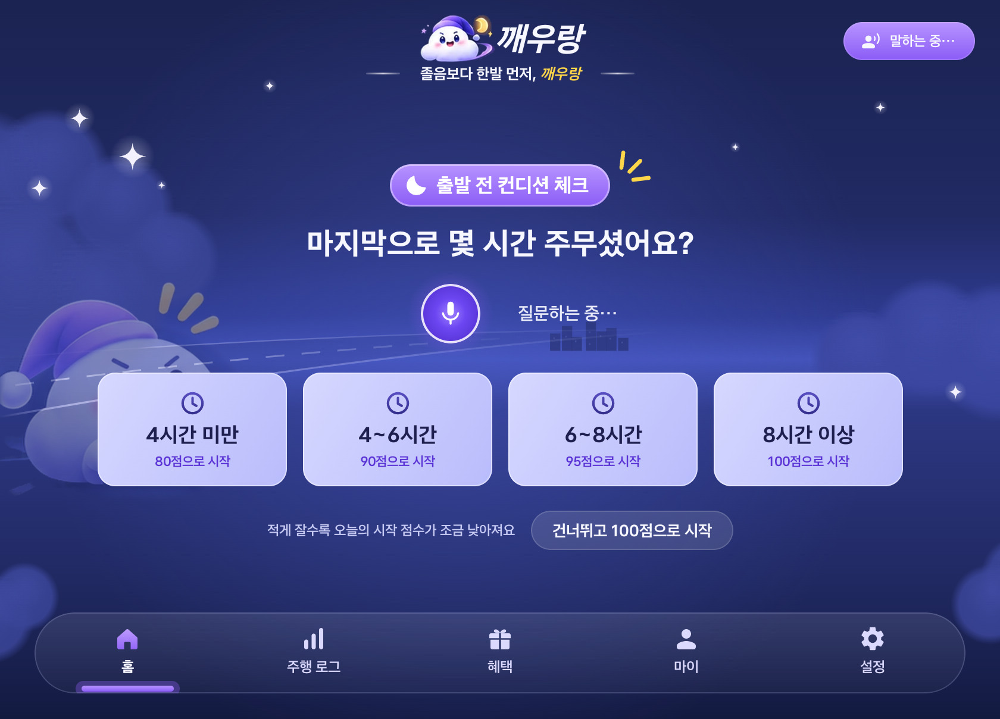
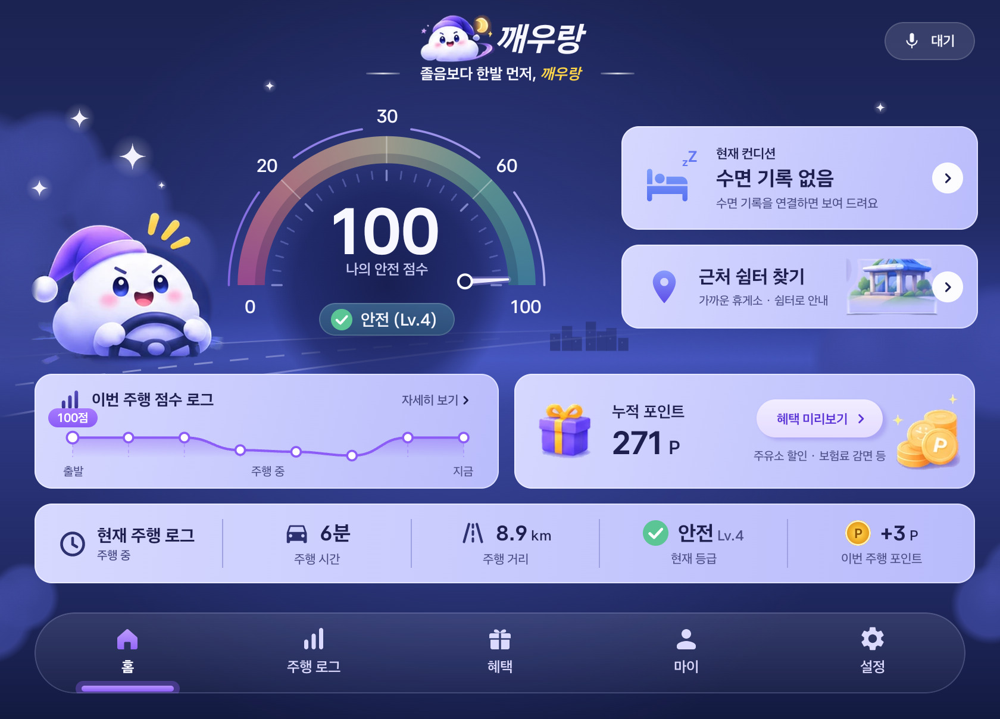
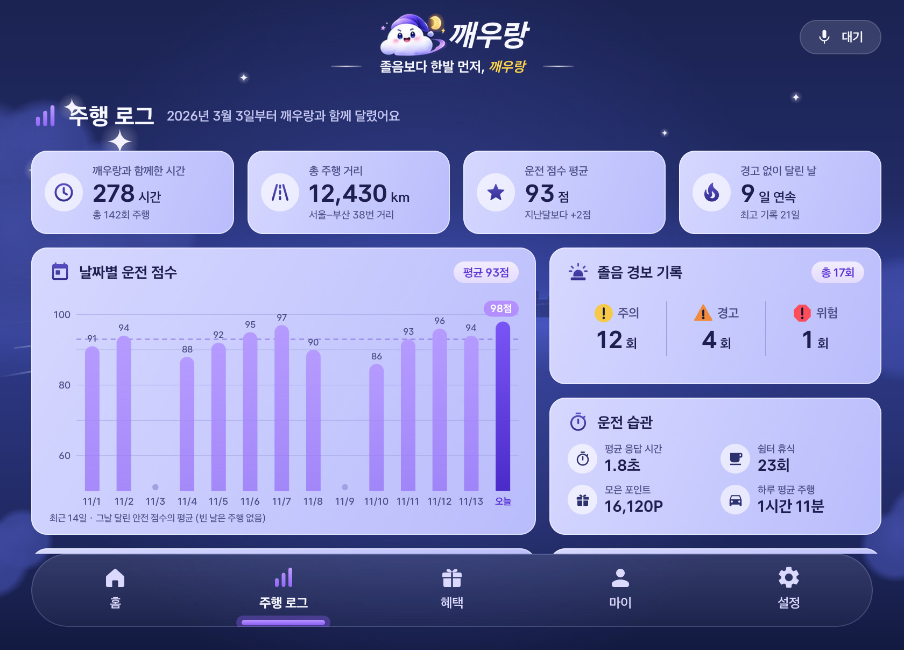
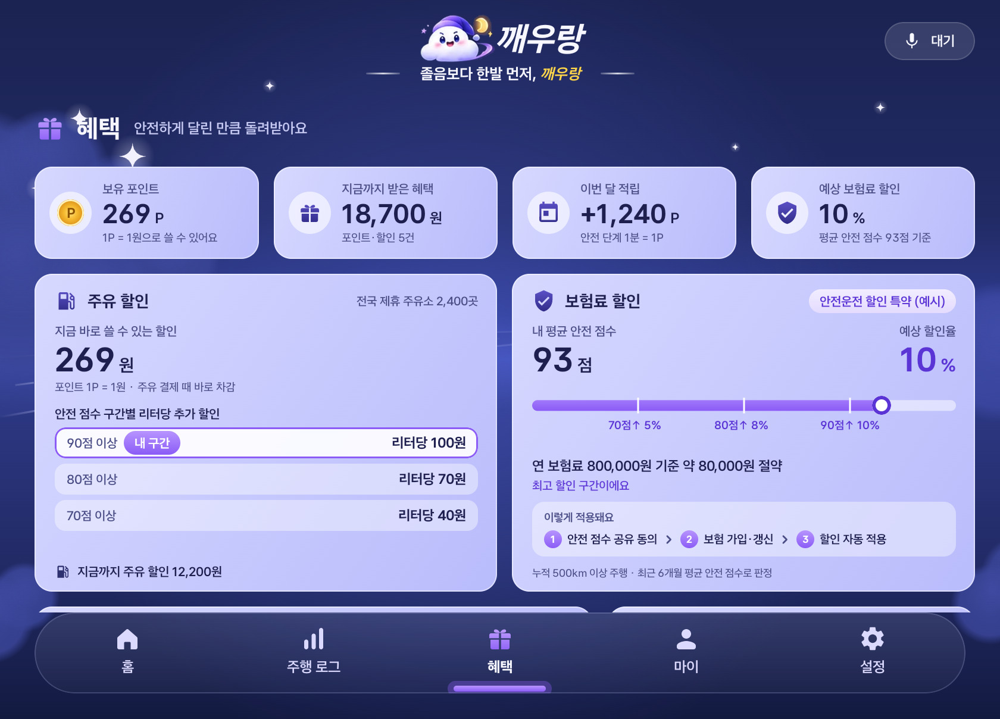
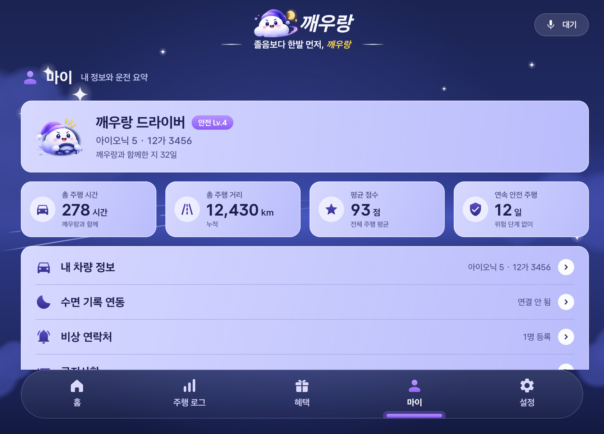
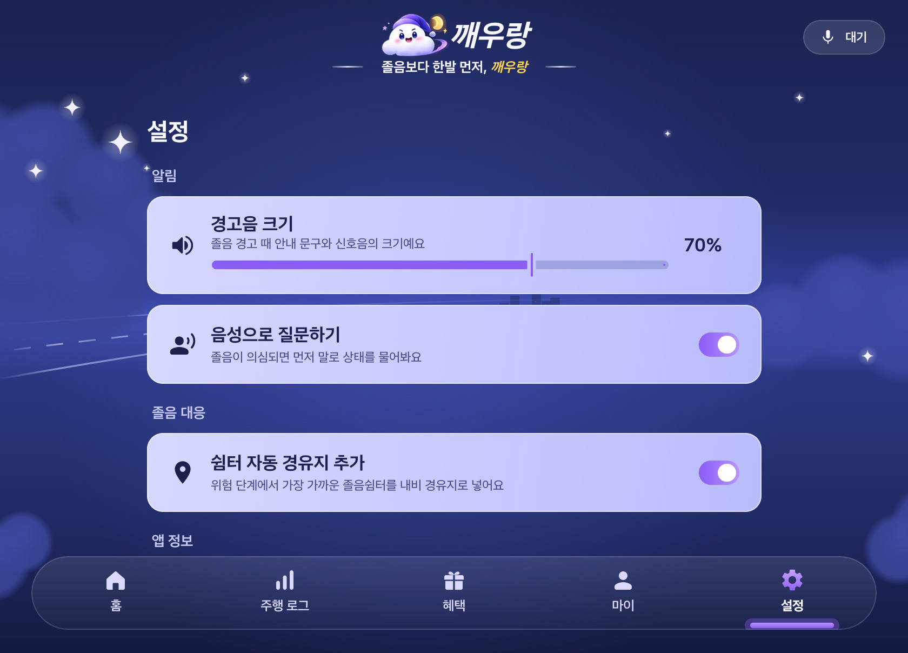
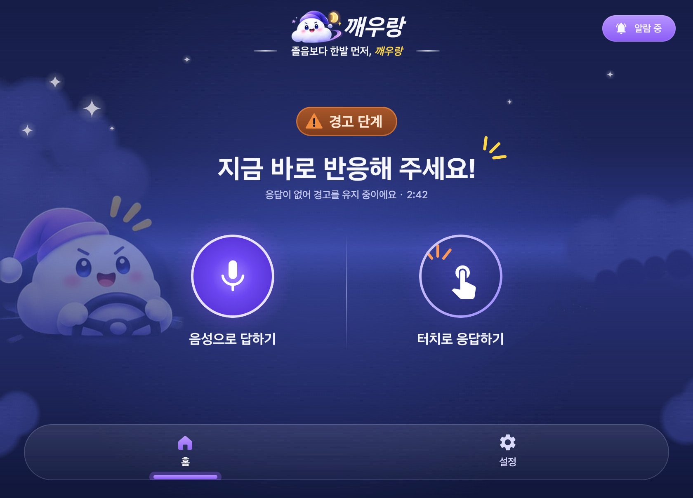
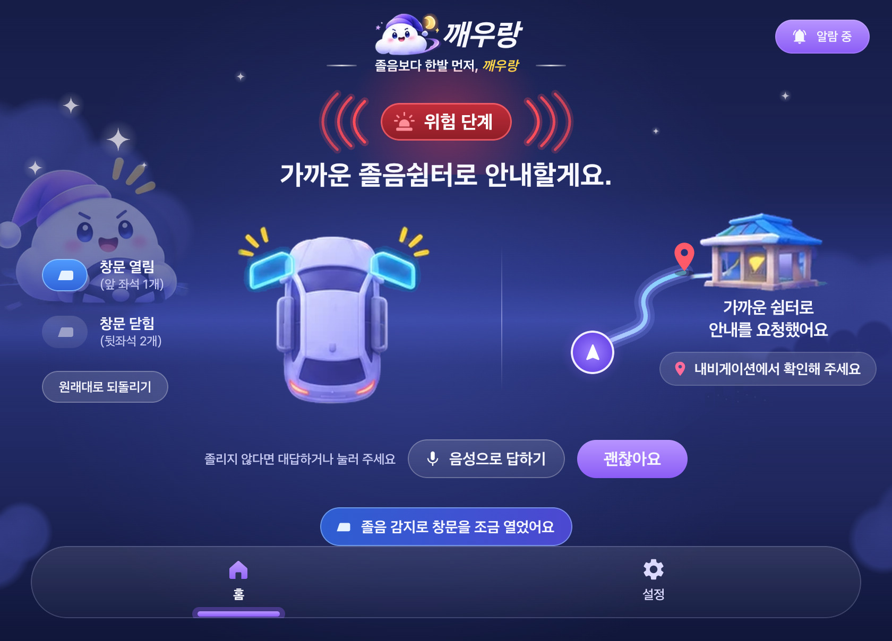
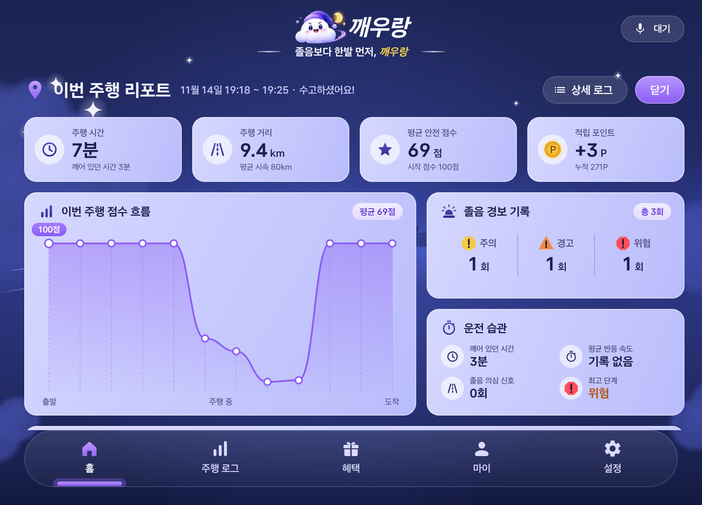
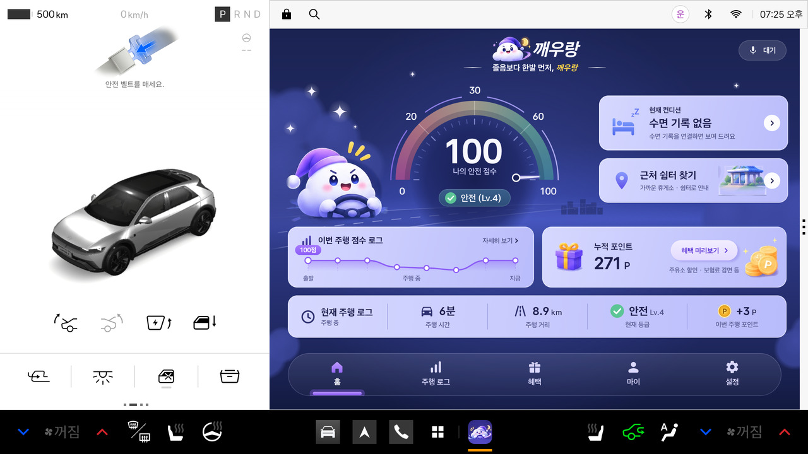

<div align="center">


# 깨우랑 (KkaeU-rang)

**졸음보다 한발 먼저, 깨우랑**

졸음이 오는 순간 운전자를 깨우고, 쉴 곳까지 안내하는 **Pleos Connect 차량용 졸음운전 예방 앱**


</div>

---

## 목차

1. [앱 소개](#1-앱-소개)
2. [실행 화면](#2-실행-화면)
3. [실행 방법](#3-실행-방법)
4. [테스트 환경 및 필요한 설정](#4-테스트-환경-및-필요한-설정)
5. [Pleos Connect 에뮬레이터 버전과 화면 규격](#5-pleos-connect-에뮬레이터-버전과-화면-규격)
6. [APK 파일 위치 / GitHub Release](#6-apk-파일-위치--github-release)
7. [기술 스택과 프로젝트 구조](#7-기술-스택과-프로젝트-구조)

---

## 1. 앱 소개

| 항목 | 내용 |
| --- | --- |
| 앱 이름 | **깨우랑** (KkaeU-rang) |
| 한 줄 소개 | 졸음이 오는 순간 운전자를 깨우고, 쉴 곳까지 안내하는 졸음운전 예방 앱 |
| 대상 플랫폼 | Pleos Connect (Android Automotive OS, API 34) |
| 패키지 이름 | `com.sleepreaper.kkaeurang` |

### 주요 기능

- **실시간 안전 점수**: 1초마다 차량 신호(차속·핸들 각도·방향지시등·브레이크·기어)를 읽어 **100점에서 감점**하는 방식으로 안전 점수를 계산합니다.
- **졸음 4단계 판단과 단계별 대응**

  | 단계 | 안전 점수 | 깨우랑의 대응 |
  | --- | --- | --- |
  | 🟢 안전 | 61 ~ 100 | 홈 대시보드에 점수·주행 정보 표시 |
  | 🟡 주의 | 31 ~ 60 | 음성(TTS)으로 "괜찮으세요?"라고 묻고 음성(STT)·터치로 대답을 받음 |
  | 🟠 경고 | 21 ~ 30 | 경고 알람을 울리고 음성·터치 응답을 요구 (주의 단계 질문에 대답이 없어도 경고로 올리고 3분간 유지) |
  | 🔴 위험 | 0 ~ 20 | 운전석 창문을 30% 열고(10점 이하면 60%, 비가 오면 창문 대신) 찬바람을 켜며, 가장 가까운 **졸음쉼터를 내비게이션 경유지로 추가** |

- **졸음 판단 규칙** (감점은 시간이 지나면 조금씩 회복: 1초에 0.05점)

  | 규칙 | 조건 | 감점 |
  | --- | --- | --- |
  | ① 핸들 고정 | 시속 60km 이상에서 10초 넘게 핸들 각도 변화가 ±1° 이내 | 15 |
  | ② 급조작 | ① 직후 1초 사이 핸들을 15° 이상 꺾음 | 25 |
  | ③ 쏠림 | 방향지시등 없이 3초 넘게 한쪽(8° 이상)으로 쏠림 | 15 |
  | ④ 속도 불안정 | 브레이크 없이 1분 동안 속도 표준편차 8km/h 이상 | 10 |
  | ⑤ 장시간 운전 | 연속 주행 2시간 이상 | 10 |
  | ⑥ 위험 시간대 | 02:00 ~ 04:59, 14:00 ~ 15:59 | 15 |

- **출발 전 컨디션 체크**: 앱을 켜면 지난밤 수면 시간을 묻고(음성 또는 터치), 수면 시간에 따라 오늘의 시작 점수(80 ~ 100점)를 정합니다.
- **주행 리포트**: 기어를 P로 바꿔 주행을 마치면 주행 시간·거리·평균 안전 점수·점수 흐름·경보 횟수를 한 화면에 정리해 보여 줍니다.
- **주행 로그 / 혜택 / 마이 / 설정**: 날짜별 운전 점수, 안전 운전 포인트와 주유·보험 혜택, 내 정보, 경고음·음성 질문·쉼터 경유지 설정을 제공합니다.
- **화면을 벗어나도 계속 감시**: 졸음 감시는 포그라운드 서비스로 돌아가므로 다른 앱(내비 등)을 보고 있어도 판단과 경보가 이어집니다.

---

## 2. 실행 화면

> 모든 화면은 Pleos Connect v2.1.0 에뮬레이터에서 직접 캡처했습니다.
> 앱이 실제로 쓰는 영역(1680 × 1208)만 잘랐습니다. 차량 패널·상태 표시줄·하단 독까지 포함한 전체 화면은 [5장](#5-pleos-connect-에뮬레이터-버전과-화면-규격)에 있습니다.

### 2-1. 앱 시작 · 탭 화면

| 로딩 화면 | 출발 전 컨디션 체크 |
| :---: | :---: |
|  |  |
| 졸음 감시 엔진을 준비하는 동안 보이는 시작 화면 | 수면 시간을 묻고 오늘의 시작 점수를 정함 |

| 메인 홈 | 주행 로그 |
| :---: | :---: |
|  |  |
| 안전 점수 계기판, 이번 주행 점수 로그, 누적 포인트, 현재 주행 정보 | 누적 주행 통계, 날짜별 운전 점수, 졸음 경보 기록, 운전 습관 |

| 혜택 | 마이페이지 |
| :---: | :---: |
|  |  |
| 보유 포인트, 주유 할인, 안전 점수 구간별 보험료 할인 | 운전자·차량 정보, 누적 운전 요약, 수면 기록 연동·비상 연락처 |

| 설정 |
| :---: |
|  |
| 경고음 크기, 음성으로 질문하기, 쉼터 자동 경유지 추가 |

### 2-2. 메인 홈: 졸음 단계별 화면

| 🟢 안전 | 🟡 주의 |
| :---: | :---: |
|  |  |
| 평소 주행 화면 (안전 점수 61 이상) | 음성으로 상태를 묻고, 음성 또는 "괜찮아요" 버튼으로 대답 |

| 🟠 경고 | 🔴 위험 |
| :---: | :---: |
|  |  |
| 알람과 함께 음성·터치 응답을 요구 (무응답이면 3분간 경고 유지) | 창문 열기·찬바람, 가까운 졸음쉼터로 내비 안내 요청 |

> 경고·위험 단계에서는 운전에 집중할 수 있도록 하단 탭이 **홈·설정**만 남습니다.

### 2-3. 주행 종료: 주행 리포트

| 이번 주행 리포트 |
| :---: |
|  |
| 기어를 P로 바꾸면 표시됩니다. 주행 시간·거리, 평균 안전 점수, 적립 포인트, 점수 흐름 그래프, 졸음 경보 기록(주의·경고·위험 횟수), 운전 습관을 보여 주고 "상세 로그"에서 사건 기록을 시간순으로 볼 수 있습니다. |

---

## 3. 실행 방법

### 사전 준비

- **Android Studio** (개발에 사용한 버전: 2026.2.2, 내장 JDK(JBR) 사용)
- Android SDK Platform **37** (compileSdk / targetSdk 37)
- **Pleos Connect v2.1.0 에뮬레이터** (설치·설정은 [5장](#5-pleos-connect-에뮬레이터-버전과-화면-규격) 참고)
- 인터넷 연결: Pleos SDK를 Pleos 공개 Maven 저장소(`https://nexus-playground.pleos.ai/repository/maven-releases/`)에서 받습니다. 저장소 주소는 `settings.gradle.kts`에 이미 들어 있어 따로 설정할 것은 없습니다.

### 방법 A. Android Studio로 실행

1. 저장소를 클론합니다.

   ```bash
   git clone https://github.com/Sleep-Reaper/KkaeU-rang.git
   ```

2. Android Studio에서 `KkaeU-rang` 폴더를 열고 Gradle Sync가 끝날 때까지 기다립니다.
3. Device Manager에서 **Pleos Connect v2.1.0** 에뮬레이터를 실행합니다. 처음 부팅 직후에는 시스템 앱이 바쁘므로 **몇 분 기다린 뒤** 앱을 실행하는 것이 좋습니다.
4. 실행 구성 `app`을 선택하고 ▶ Run을 누릅니다.
5. 처음 실행하면 **마이크·알림·차량 권한**을 물어봅니다. 모두 **허용**해 주세요.

### 방법 B. 명령줄로 빌드·설치

Android Studio 내장 JDK로 빌드합니다 (아래 경로는 Windows 기본 설치 위치 기준).

```bash
JAVA_HOME="/c/Program Files/Android/Android Studio/jbr" ./gradlew :app:assembleDebug
```

```bash
adb install -r app/build/outputs/apk/debug/app-debug.apk
```

```bash
adb shell am start -n com.sleepreaper.kkaeurang/.MainActivity
```

### 앱 사용 흐름

1. **로딩 화면** → **출발 전 컨디션 체크**: 수면 시간을 말하거나 버튼으로 고르면 시작 점수가 정해지고, "건너뛰고 100점으로 시작"을 누르거나 대답이 없으면 100점으로 시작합니다.
2. **메인 홈**: 주행하는 동안 안전 점수와 단계가 실시간으로 바뀝니다.
3. 점수가 내려가면 **주의 → 경고 → 위험** 화면으로 바뀌고, 운전자가 대답하거나 점수가 회복되면 홈으로 돌아옵니다.
4. 기어를 **P**로 바꾸면 **이번 주행 리포트**가 열립니다.

### 단위 테스트

```bash
JAVA_HOME="/c/Program Files/Android/Android Studio/jbr" ./gradlew :app:testDebugUnitTest
```

졸음 판단 규칙, 점수·단계 경계, 창문 제어, 운전자 대답 분류, 수면 시간 인식, 졸음쉼터 찾기 등 **152개 테스트**가 있습니다 (2026-11-15 기준 모두 통과).

---

## 4. 테스트 환경 및 필요한 설정

### 테스트 환경

| 항목 | 내용 |
| --- | --- |
| 에뮬레이터 | Pleos Connect v2.1.0 (Android 14, API 34, x86_64) |
| 호스트 OS | Windows 11 |
| IDE | Android Studio 2026.2.2 |
| 빌드 도구 | Gradle 9.6.0, Android Gradle Plugin 9.5.1 |
| SDK 버전 | minSdk 28 / targetSdk 37 / compileSdk 37 |

### 필요한 권한

앱을 처음 실행할 때 아래 권한을 요청합니다. **모두 허용해야** 모든 기능이 동작합니다.

| 권한 | 용도 | 거부하면 |
| --- | --- | --- |
| `RECORD_AUDIO` (마이크) | 졸음 감시 서비스(마이크 타입 포그라운드 서비스) 시작 | 졸음 감시 서비스가 시작되지 않음 (권한 안내 화면 표시) |
| `POST_NOTIFICATIONS` (알림) | 졸음 감시 중 상시 알림 | 알림만 보이지 않고 감시는 동작 |
| `android.car.permission.CAR_SPEED`, `CAR_POWERTRAIN`<br>`pleos.car.permission.CAR_DRIVE`, `CAR_LIGHTS` | 차속·기어·핸들·브레이크·방향지시등 읽기 | 실제 차량 신호를 받지 못함 |
| `pleos.car.permission.CAR_WINDOWS`, `CONTROL_CAR_WINDOWS`<br>`CAR_CLIMATE`, `CONTROL_CAR_CLIMATE` | 위험 단계에서 창문 열기·찬바람 | 창문을 열지 못하고 화면에 "창문 닫힘"으로 표시 |

아래 Pleos 서비스 권한은 `AndroidManifest.xml`에 선언되어 있어 따로 허용할 필요가 없습니다.

- `pleos.car.permission.TTS_SERVICE`, `STT_SERVICE`: 음성 질문(TTS)과 음성 인식(STT)
- `pleos.car.permission.NAVI_ROUTE`, `NAVI_ROUTE_SEARCH`, `NAVI_CUSTOM_*`: 졸음쉼터를 내비 경유지로 추가

### 실행 모드 설정 (`MainActivity.kt`)

에뮬레이터에는 실제로 달리는 차량 신호가 없으므로, `MainActivity.kt`의 `APP_MODE` 값으로 동작 방식을 고릅니다.

| 값 | 설명 |
| --- | --- |
| `LIVE` | 실차용. 판단 엔진 + 음성 + **실제 차량 신호** |
| `LIVE_SIMULATED` (기본값) | 에뮬레이터용. 판단 엔진과 음성은 실제로 동작하고, **차량 신호만 가짜**(약 시속 80km 주행)로 넣습니다 |
| `FAKE_DEMO` | 가짜 데이터로 UI만 시연 (판단 엔진은 돌지 않음) |

```kotlin
private val APP_MODE = AppMode.LIVE_SIMULATED   // 실차에서는 LIVE
private const val LIVE_DEBUG_PANEL = true       // 배포 때는 false
```

### 시연용 엔진 디버그 패널

`LIVE_DEBUG_PANEL = true`일 때 헤더 가운데의 **깨우랑 로고**(또는 홈의 안전 점수 계기판)를 **길게 누르면** 엔진 디버그 패널이 열립니다. 에뮬레이터에서 단계별 화면을 재현할 때 사용합니다.

| 하고 싶은 것 | 디버그 패널 조작 |
| --- | --- |
| 주의 단계 보기 | `+30` 두 번 (안전 점수 40) |
| 경고 단계 보기 | 주의 단계에서 `+10` 한 번 (안전 점수 30), 또는 주의 단계 질문에 대답하지 않기 |
| 위험 단계 보기 | 경고 단계에서 `+10`을 한두 번 더 (안전 점수 20 이하) |
| 실제 규칙으로 감점 | 주행 시나리오 ①~④ 버튼 (가짜 차량 신호를 넣어 엔진 규칙이 직접 판단) |
| 안전 단계로 되돌리기 | `이벤트 점수 0으로` |
| 주행 종료 → 리포트 | `기어 P (주행 종료)` 켜기 (주행 1분 이상, P단 3초 유지 후 리포트 표시) |
| 장시간 운전·위험 시간대 | `+10분`, `+1시간`, `다음 위험 시간대로` |

> 디버그 패널의 `+` 버튼은 **감점을 늘리는** 버튼입니다 (`+30` = 안전 점수 30점 감소).

### 참고 사항

- 에뮬레이터 마이크는 주변 소음을 들을 수 있어 음성 인식 결과가 엉뚱하게 나오면 한 번 다시 묻습니다. 터치 버튼으로도 항상 대답할 수 있습니다.
- 위험 단계에서 졸음쉼터 안내를 요청하면 Pleos 내비게이션 화면이 앞으로 나올 수 있습니다. 하단 독의 깨우랑 아이콘을 누르면 앱으로 돌아옵니다.
- 설치 직후 첫 실행에서는 음성 인식 엔진 준비에 20초 정도 걸릴 수 있습니다.

---

## 5. Pleos Connect 에뮬레이터 버전과 화면 규격

### 에뮬레이터

| 항목 | 값 |
| --- | --- |
| AVD 이름 | `Pleos_Connect_v2.1.0` (표시 이름: Pleos Connect v2.1.0) |
| 시스템 이미지 | `system-images/android-34/pleos_car_emulator/x86_64` (tag: `android-automotive`) |
| 빌드 | `RELEASE.release_connect_v2.1.0` |
| Android 버전 | Android 14 (API 34) |
| CPU / RAM | x86_64 / 4 GB |

### 화면 규격

| 항목 | 값 |
| --- | --- |
| 전체 해상도 | **2560 × 1440 px** |
| 화면 밀도 | **160 dpi (mdpi, 1dp = 1px)** |
| 앱 표시 영역 | **1680 × 1208 px** (= 1680 × 1208 dp) |
| 왼쪽 차량 패널 (Pleos 고정) | 너비 854 px |
| 위쪽 상태 표시줄 | 높이 91 px |
| 아래쪽 독 | 높이 141 px |

깨우랑의 모든 화면은 실제 앱 영역(1680 × 1208dp)을 기준으로 설계했습니다.

<div align="center">

<br />
<sub>Pleos Connect v2.1.0 에뮬레이터 전체 화면 (왼쪽 차량 패널, 위쪽 상태 표시줄, 아래쪽 독 포함)</sub>
</div>

---

## 6. APK 파일 위치 / GitHub Release

| 구분 | 위치 |
| --- | --- |
| 직접 빌드한 APK | `app/build/outputs/apk/debug/app-debug.apk` ([3장 방법 B](#방법-b-명령줄로-빌드설치)로 빌드) |
| 배포용 APK | [GitHub Releases](https://github.com/Sleep-Reaper/KkaeU-rang/releases) |

<!-- TODO: Release에 APK를 올린 뒤 위 링크를 해당 릴리스 주소(예: .../releases/tag/v1.0)로 바꾸기 -->

- APK 파일은 용량 때문에 저장소(git)에는 넣지 않습니다 (`.gitignore`에서 `*.apk` 제외).
- 설치: `adb install -r app-debug.apk`

---

## 7. 기술 스택과 프로젝트 구조

### 기술 스택

| 분류 | 사용 기술 |
| --- | --- |
| 언어 | Kotlin 2.2.10 |
| UI | Jetpack Compose (BOM 2026.02.01), Material 3, SplashScreen API |
| 비동기 | Kotlin Coroutines / StateFlow |
| 차량 | Android Car API (`android.car`), Pleos Vehicle SDK 2.3.2 |
| 음성 | Pleos TextToSpeech 3.3.1, Pleos SpeechToText 3.3.1 |
| 내비 | Pleos NaviHelper 2.0.3 (졸음쉼터 경유지 추가) |
| 데이터 | 고속도로 졸음쉼터 253곳 위치·방향 (`app/src/main/assets/rest_stops.csv`) |
| 테스트 | JUnit 4 |

### 프로젝트 구조

```text
app/src/main/java/com/sleepreaper/kkaeurang/
├── MainActivity.kt          # 진입점, 실행 모드(APP_MODE)·권한 요청
├── detector/                # 졸음 판단 엔진: 규칙 ①~⑥, 안전 점수, 단계, 창문·공조 판단
├── integration/             # 포그라운드 서비스, 차량 신호·창문 제어 연결, 내비 연동, 주행 로그 변환
├── reststop/                # 졸음쉼터 데이터 읽기와 가장 가까운 쉼터 찾기
├── voice/                   # TTS·STT, 경고음
└── ui/
    ├── screens/             # 홈·경보·주행 로그·혜택·마이·설정·주행 리포트·시작 화면
    ├── components/          # 계기판, 카드, 헤더, 하단 탭, 밤하늘 배경
    ├── debug/               # 엔진 디버그 패널 (시연용)
    ├── model/ · state/      # UI 상태 모델
    └── theme/               # 색·글꼴·디자인 토큰
```
